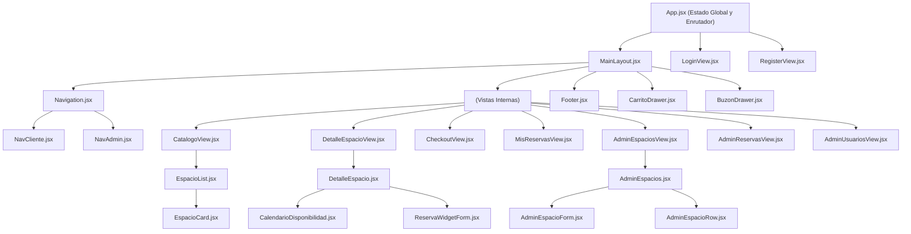

# Guía y Documentación de Componentes — Frontend Whispering Pines

Este documento detalla la estructura, responsabilidad y funcionamiento de todos los componentes y vistas que integran la aplicación frontend del sistema de reserva de cabañas y eventos.

---

## 📐 Principios de Arquitectura (Basados en las Clases 8, 9 y 10)

1. **Single Page Application (SPA)**: Se carga un único documento HTML (`index.html`), montado en `main.jsx` mediante `BrowserRouter`. El enrutador alterna las pantallas dinámicamente sin recargar la página.
2. **Separación Vistas vs. Componentes**:
   * **Vistas (`src/views/`)**: Son las pantallas principales asociadas a una ruta. Tienen mínima lógica interna; su función es actuar como orquestadoras que ensamblan componentes más pequeños.
   * **Componentes (`src/components/`)**: Son bloques visuales y funcionales reutilizables, modulares y de responsabilidad única.
3. **Flujo Unidireccional de Datos**:
   * **Los datos bajan**: El componente padre que posee el estado lo transmite a sus hijos a través de **props**.
   * **Los eventos suben**: Los hijos notifican acciones al padre ejecutando funciones callback pasadas por props.
4. **Formularios Controlados**: Todos los inputs están enlazados a variables de estado (`value`) y se actualizan mediante el evento `onChange`. Los envíos previenen la recarga nativa con `e.preventDefault()`.

---

## 🗂️ Índice General

1. [Núcleo de la Aplicación (App y Main)](#1-núcleo-de-la-aplicación)
2. [Vistas / Pantallas (Views)](#2-vistas--pantallas-views)
   - [LoginView](#loginviewjsx)
   - [RegisterView](#registerviewjsx)
   - [CatalogoView](#catalogoviewjsx)
   - [DetalleEspacioView](#detalleespacioviewjsx)
   - [CheckoutView](#checkoutviewjsx)
   - [MisReservasView](#misreservasviewjsx)
   - [AdminEspaciosView](#adminespaciosviewjsx)
   - [AdminReservasView](#adminreservasviewjsx)
   - [AdminUsuariosView](#adminusuariosviewjsx)
3. [Componentes de Layout y Navegación](#3-componentes-de-layout-y-navegación)
4. [Componentes de Autenticación (Auth)](#4-componentes-de-autenticación-auth)
5. [Componentes de Catálogo](#5-componentes-de-catálogo)
6. [Componentes de Detalle de Espacio](#6-componentes-de-detalle-de-espacio)
7. [Componentes de Carrito y Checkout](#7-componentes-de-carrito-y-checkout)
8. [Componentes de Reservas y Notificaciones](#8-componentes-de-reservas-y-notificaciones)
9. [Componentes de Administración (Admin)](#9-componentes-de-administración-admin)
10. [Componentes de UI Reutilizables](#10-componentes-de-ui-reutilizables)

---

## 1. Núcleo de la Aplicación

### `main.jsx`
* **Ubicación**: `src/main.jsx`
* **Función**: Punto de entrada de JavaScript. Toma el elemento `#root` del DOM y monta el componente raíz `App` dentro de `StrictMode` y `BrowserRouter` de `react-router-dom`.

### `App.jsx`
* **Ubicación**: `src/App.jsx`
* **Función**: Componente padre supremo de la jerarquía.
  * **Estado Global**: Administra la sesión (`token`, `isLogged`, `rolUsuario`, `nombreUsuario`), el carrito de compras (`carritoData`), el buzón de cancelaciones (`mensajesBuzon`) y el espacio seleccionado para ver detalle.
  * **Enrutamiento Central (`Routes` y `Route`)**: Define la tabla de rutas de la SPA y utiliza `MainLayout` como plantilla envolvente para las rutas internas.
  * **Control de Acceso y Redirección**: Mediante un `useEffect` con `useLocation` y `useNavigate`, verifica en cada cambio de ruta si el usuario tiene permiso:
    * Si no está autenticado e intenta ir a rutas privadas (`/admin/*`, `/checkout`, `/mis-reservas`), lo redirige a `/login`.
    * Si es administrador, lo redirige siempre a `/admin/espacios` (impidiendo que vea el catálogo).
    * Si es cliente y va a `/admin/*`, lo devuelve al `/catalogo`.

---

## 2. Vistas / Pantallas (Views)

Las vistas representan las páginas de la aplicación y se encuentran en `src/views/`.

### `LoginView.jsx`
* **Ruta asociada**: `/login`
* **Propósito**: Pantalla de acceso al sistema para huéspedes y administradores.
* **Componentes que renderiza**:
  * `AuthBanner`: Imagen y mensaje de bienvenida a la izquierda.
  * `LoginForm`: Formulario interactivo de credenciales a la derecha.
* **Props que recibe**: `idioma`, `setIdioma`, `onLogin`.

### `RegisterView.jsx`
* **Ruta asociada**: `/register`
* **Propósito**: Pantalla para que un nuevo usuario cree su cuenta de huésped (`ROLE_CLIENTE`).
* **Componentes que renderiza**:
  * `AuthBanner`: Banner ilustrativo.
  * `RegisterForm`: Formulario con nombre, apellido, usuario, email y contraseña.
* **Props que recibe**: `idioma`, `setIdioma`, `onLogin`.

### `CatalogoView.jsx`
* **Ruta asociada**: `/` y `/catalogo`
* **Propósito**: Pantalla principal para explorar los alojamientos y salones del complejo.
* **Componentes que renderiza**:
  * Hero banner con el título principal y mapa ilustrado.
  * `EspacioList`: Listado y filtrado de cabañas y salones.
* **Props que recibe**: `idioma`, `onAbrirDetalle`.

### `DetalleEspacioView.jsx`
* **Ruta asociada**: `/detalle`
* **Propósito**: Muestra la información exhaustiva de un espacio seleccionado (fotos, precio, comodidades, calendario de ocupación y widget de reserva).
* **Componentes que renderiza**:
  * `DetalleEspacio`: Ensambla la ficha técnica, la galería y el widget.
* **Props que recibe**: `idioma`, `espacio`, `isLogged`, `setCarritoData`, `onAbrirCarrito`.

### `CheckoutView.jsx`
* **Ruta asociada**: `/checkout`
* **Propósito**: Pantalla de confirmación y cierre de reserva de los elementos cargados en el carrito.
* **Componentes que renderiza**:
  * `PageHeader`: Encabezado con título e instrucciones.
  * `CheckoutResumen`: Formulario de datos de contacto y facturación con desglose de costos.
* **Props que recibe**: `idioma`, `carritoData`, `setCarritoData`.

### `MisReservasView.jsx`
* **Ruta asociada**: `/mis-reservas`
* **Propósito**: Historial de reservas del huésped autenticado, con capacidad de cancelar estadías futuras.
* **Componentes que renderiza**:
  * `PageHeader`: Encabezado de la pantalla.
  * `MisReservasList`: Mapeo de tarjetas de reservas con sus estados (CONFIRMADA, CANCELADA).
* **Props que recibe**: `idioma`, `ocultasIds`, `setOcultasIds`.

### `AdminEspaciosView.jsx`
* **Ruta asociada**: `/admin/espacios`
* **Propósito**: Consola de gestión de inventario para el staff administrativo.
* **Componentes que renderiza**:
  * `PageHeader`: Título "Gestión de Espacios".
  * `AdminEspacios`: Formulario de alta y tabla de actualización de precios y estado activo/mantenimiento.
* **Props que recibe**: `idioma`.

### `AdminReservasView.jsx`
* **Ruta asociada**: `/admin/reservas`
* **Propósito**: Libro de operaciones global para ver las reservas de todos los huéspedes del complejo.
* **Componentes que renderiza**:
  * `PageHeader`: Título "Registro Maestro de Reservas".
  * `AdminReservas`: Tabla con detalle de estadías y opción de cancelación administrativa con motivo.
* **Props que recibe**: `idioma`.

### `AdminUsuariosView.jsx`
* **Ruta asociada**: `/admin/usuarios`
* **Propósito**: Gestión de cuentas de usuarios registrados en la base de datos.
* **Componentes que renderiza**:
  * `PageHeader`: Título "Directorio de Huéspedes y Personal".
  * `AdminUsuarios`: Tabla para cambiar roles (cliente/admin) y activar/desactivar cuentas.
* **Props que recibe**: `idioma`.

---

## 3. Componentes de Layout y Navegación

Ubicados en `src/components/layout/`. Definen la estructura visual común de las pantallas internas.

### `MainLayout.jsx`
* **Función**: Estructura base (*layout template*) que envuelve las rutas que comparten encabezado y pie de página.
* **Renderiza**:
  * `Navigation`: Barra de navegación superior.
  * `<Outlet />` (React Router): Espacio donde se renderiza la vista activa según la URL.
  * `Footer`: Pie de página.
  * `CarritoDrawer` y `BuzonDrawer`: Paneles deslizables laterales (solo si el usuario no es admin).

### `Navigation.jsx`
* **Función**: Actúa como selector condicional de barra de navegación.
* **Lógica**: Si `rolUsuario === 'ROLE_ADMIN'`, renderiza `NavAdmin`. En caso contrario (cliente o visitante sin autenticar), renderiza `NavCliente`.

### `NavCliente.jsx`
* **Función**: Barra de navegación para visitantes y huéspedes.
* **Elementos**:
  * Logo que lleva a `/catalogo`.
  * Enlace a "Explorar Espacios" y "Mis Reservas" (solo logueados).
  * Botón selector de idioma (ES / EN).
  * Botones con badge contador para abrir el Carrito y el Buzón de notificaciones.
  * Nombre del usuario y botón "Cerrar Sesión" (o enlaces a "Iniciar Sesión" y "Registrarse" si es visitante).

### `NavAdmin.jsx`
* **Función**: Barra de navegación especializada para el personal administrativo.
* **Elementos**:
  * Insignia "CONSOLA STAFF".
  * Pestañas directas a `/admin/espacios`, `/admin/reservas` y `/admin/usuarios`.
  * Selector de idioma, indicador de rol Admin y botón para cerrar sesión.

### `Footer.jsx`
* **Función**: Pie de página informativo con lema del complejo y copyright traducido.

### `PageHeader.jsx`
* **Función**: Encabezado estandarizado reutilizado en múltiples vistas para mostrar *overline* (categoría pequeña superior), título principal y subtítulo descriptivo.

---

## 4. Componentes de Autenticación (Auth)

Ubicados en `src/components/auth/`. Gestionan el inicio de sesión y la creación de cuentas.

### `AuthBanner.jsx`
* **Función**: Panel decorativo izquierdo en Login y Registro. Muestra una imagen ambiental del bosque, badge descriptivo y título institucional.

### `AuthFormTitulos.jsx`
* **Función**: Bloque tipográfico que renderiza la categoría, título y bajada explicativa del formulario de autenticación.

### `LoginForm.jsx`
* **Función**: Formulario controlado para ingresar email y contraseña.
* **Lógica**:
  1. Valida campos no vacíos en memoria.
  2. Ejecuta un `POST` contra `/api/auth/login` con `auth: false`.
  3. Al recibir la respuesta con el JWT y el rol, guarda el token en `localStorage` y llama a la callback `onLogin(data)` recibida desde `App`.
  4. Soporta envío mediante botón y tecla Enter con `onSubmit={handleSubmit}` y `e.preventDefault()`.

### `RegisterForm.jsx`
* **Función**: Formulario controlado para capturar los datos de un nuevo cliente: username, nombre, apellido, email y contraseña.
* **Lógica**:
  1. Valida obligatoriedad de todos los campos.
  2. Dispara un `POST` contra `/api/auth/register` enviando los datos con rol `ROLE_CLIENTE`.
  3. Tras registrar con éxito, invoca `onLogin(data)` para autenticar al usuario y redirigirlo inmediatamente.

---

## 5. Componentes de Catálogo

Ubicados en `src/components/catalogo/`. Manejan la búsqueda y visualización de alojamientos.

### `EspacioList.jsx`
* **Función**: Contenedor principal del catálogo.
* **Lógica**:
  * En su `useEffect` de montaje ejecuta un `fetch` a `/api/espacios` para traer todos los espacios activos.
  * Mantiene un estado local `filtro` (`'TODOS'`, `'CABANA'`, `'SALON'`, `'ACTIVIDAD'`).
  * Filtra la lista en memoria según el tipo seleccionado y mapea los resultados en tarjetas `EspacioCard`.

### `EspacioCard.jsx`
* **Función**: Tarjeta individual de presentación de una cabaña o salón.
* **Renderiza**: Foto principal (usando `imagenPrincipal`), badge del tipo de espacio, título, precio base por noche y botón "Ver Fechas y Reservar" que invoca `onAbrirDetalle(espacio)`.

---

## 6. Componentes de Detalle de Espacio

Ubicados en `src/components/detalle/`. Permiten explorar un espacio en profundidad y armar una reserva.

### `DetalleEspacio.jsx`
* **Función**: Contenedor maestro de la ficha de detalle.
* **Renderiza**:
  * Galería interactiva de imágenes (foto grande principal + miniaturas).
  * Lista de comodidades (capacidad, Wi-Fi, parrilla, etc.).
  * `CalendarioDisponibilidad`: Muestra qué días del mes ya están reservados.
  * `ReservaWidgetForm`: Formulario para elegir fechas y reservar.

### `FotoMiniatura.jsx`
* **Función**: Miniatura clickeable que actualiza la foto activa principal en la galería de fotos.

### `CalendarioDisponibilidad.jsx`
* **Función**: Calendario mensual interactivo.
* **Lógica**: Trae las fechas ocupadas del espacio desde `/api/reservas/espacio/{id}/fechas-ocupadas`. Con `armarCeldasMes` (de `utils/fechas.js`) construye los días del mes y clasifica cada fecha como pasada, ocupada o disponible.

### `CalendarioDia.jsx`
* **Función**: Celda unitaria del almanaque. Aplica estilos diferenciados según el estado del día (deshabilitado en gris si es pasado u ocupado, blanco si está disponible).

### `ReservaWidgetForm.jsx`
* **Función**: Panel lateral de contratación.
* **Lógica**:
  * Contiene los inputs de fecha `checkIn` y `checkOut`.
  * Valida que check-out sea posterior a check-in y que el usuario esté autenticado.
  * Integra `ReservaWidgetInfo` para mostrar el cálculo de noches y costo.
  * Al hacer click en "Agregar a la Estadía", ejecuta un `POST` a `/api/carrito/items`, actualiza el carrito global y abre automáticamente el drawer del carrito.

### `ReservaWidgetInfo.jsx`
* **Función**: Muestra en tiempo real la cantidad de noches calculadas, el desglose de precio y la notificación de descuento (10% OFF si la estadía supera los 3 días).

---

## 7. Componentes de Carrito y Checkout

Ubicados en `src/components/carrito/`. Gestionan las estadías seleccionadas antes de pagarlas.

### `CarritoDrawer.jsx`
* **Función**: Panel lateral deslizable (*off-canvas*) que muestra el contenido actual del carrito de compras.
* **Lógica**: Se abre desde cualquier parte de la web mediante el botón de la barra de navegación o al agregar un ítem. Permite vaciar el carrito o remover ítems puntuales.

### `CarritoHeader.jsx`
* **Función**: Barra superior del drawer con el contador de espacios y botón de cierre (`✕`).

### `CarritoItem.jsx`
* **Función**: Fila de cada reserva agregada al carrito: foto, nombre del espacio, rango de fechas y botón para eliminar el ítem llamando a `DELETE /api/carrito/items/{id}`.

### `CarritoFooter.jsx`
* **Función**: Pie del drawer. Muestra el total sin descuento, el descuento por estadía prolongada aplicado y el botón "Iniciar Reserva" que redirige a `/checkout`.

### `CheckoutResumen.jsx`
* **Función**: Formulario de checkout y procesamiento final de reserva.
* **Lógica**:
  * Solicita datos de contacto y motivo del viaje.
  * Al confirmar con "Confirmar y Abonar", llama a `POST /api/reservas/confirmar`, vacía el carrito en el estado global y redirige al usuario a `/mis-reservas`.

### `CheckoutItem.jsx`
* **Función**: Tarjeta compacta de resumen de cada espacio en la pantalla de checkout.

### `CheckoutTotales.jsx`
* **Función**: Cuadro de liquidación final con subtotal, deducción de descuento y monto neto a abonar.

---

## 8. Componentes de Reservas y Notificaciones

Ubicados en `src/components/reservas/`.

### `MisReservasList.jsx`
* **Función**: Contenedor del historial de reservas del huésped.
* **Lógica**: En su montaje consulta `GET /api/reservas/mis-reservas`. Mapea cada reserva activa o pasada en componentes `ReservaCard`.

### `ReservaCard.jsx`
* **Función**: Ficha visual de una reserva concreta: ID de reserva, fechas, espacios involucrados, monto y estado (`CONFIRMADA` o `CANCELADA`).
* **Acciones**:
  * Si está confirmada, permite cancelarla mediante `PATCH /api/reservas/{id}/cancelar`.
  * Si fue cancelada por la administración, muestra el motivo de cancelación y permite ocultar la tarjeta de la vista.

### `BuzonDrawer.jsx`
* **Función**: Panel lateral deslizable de notificaciones para avisar al huésped si una de sus reservas fue cancelada por mantenimiento o decisión del staff.

### `BuzonItem.jsx`
* **Función**: Tarjeta individual de aviso dentro del buzón con fecha, motivo y botón de "Marcar como leída".

---

## 9. Componentes de Administración (Admin)

Ubicados en `src/components/admin/` divididos en 3 subcarpetas. Solo accesibles para usuarios con rol `ROLE_ADMIN`.

### A) Espacios (`src/components/admin/espacios/`)

* **`AdminEspacios.jsx`**: Panel principal de inventario. Carga todos los espacios (activos e inactivos) mediante `GET /api/admin/espacios`. Permite crear nuevos o editar existentes.
* **`AdminEspacioForm.jsx`**: Formulario colapsable para dar de alta un nuevo espacio enviando nombre, tipo, tarifa base, descripción y URLs de fotos con `POST /api/admin/espacios`.
* **`AdminEspacioRow.jsx`**: Fila individual en la tabla de espacios. Permite:
  1. Modificar la tarifa por noche directamente en un input y guardarla mediante `PUT /api/admin/espacios/{id}`.
  2. Alternar entre "Activo" y "En Mantenimiento" llamando a `DELETE` o `PATCH /restaurar`.

### B) Reservas (`src/components/admin/reservas/`)

* **`AdminReservas.jsx`**: Tabla global de control de reservas de todos los usuarios del complejo obtenidas de `GET /api/admin/reservas`.
* **`AdminReservaRow.jsx`**: Fila con ID de reserva, nombre del huésped, email, fechas y estado. Incluye un campo de texto y botón para cancelar la estadía administrativamente ingresando un motivo obligatorio (`PATCH /api/admin/reservas/{id}/cancelar`).

### C) Usuarios (`src/components/admin/usuarios/`)

* **`AdminUsuarios.jsx`**: Directorio de cuentas del sistema consultadas en `GET /api/admin/usuarios`.
* **`AdminUsuarioRow.jsx`**: Fila por usuario. Permite:
  1. Alternar su rol entre `ROLE_CLIENTE` y `ROLE_ADMIN` mediante `PUT /api/admin/usuarios/{id}/rol`.
  2. Activar o desactivar la cuenta con `PATCH /api/admin/usuarios/{id}/estado`.

---

## 10. Componentes de UI Reutilizables

Ubicados en `src/components/ui/`.

### `CampoFormulario.jsx`
* **Función**: Abstracción de un campo de formulario controlado.
* **Estructura**:
  ```jsx
  <div className={className}>
    <label>{label}</label>
    <input type={type} name={name} value={value} onChange={onChange} ... />
  </div>
  ```
* **Ventaja**: Garantiza accesibilidad y estilos homogéneos en todos los formularios de la app (Login, Registro, Checkout y Admin).

---

## 📊 Diagrama de Relación y Jerarquía


