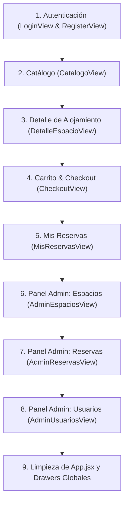

# Pautas de Refactorización y Modularidad (API - UADE)

> **PROPÓSITO DE ESTE DOCUMENTO**: Este documento establece el plan de acción realista, limpio y defendible para ordenar la modularidad del proyecto `Complejo_Frontend`. 
> Se basa al 100% en los criterios de las **Clases 7, 8, 9 y 10** de la cátedra de Aplicaciones Interactivas (UADE), evitando tanto el código monolítico como las exageraciones y delirios de IA (como prohibir métodos básicos de JavaScript o cortar componentes por conteo ciego de líneas).

---

## 1. Criterios Rectores de Modularidad (Reglas de la Cátedra)

### A. La Regla de los 3 Niveles Estrictos
Toda pantalla del sistema debe organizarse en una estructura clara de máximo **3 niveles de profundidad**:

```text
[ Nivel 1: VISTA ] (src/views/)
   └─ Representa la pantalla de una ruta (ej. /catalogo, /login, /admin/espacios).
   └─ No tiene lógica pesada, ni estados de datos, ni fetch.
   └─ Responsabilidad: componer y posicionar los bloques principales.
        │
        ▼
[ Nivel 2: COMPONENTE CONTENEDOR / LÓGICA ] (src/components/)
   └─ Responsabilidad única sobre un recurso (ej. lista de espacios, carrito, formulario).
   └─ Dueño del estado (useState), efectos (useEffect con fetch) y handlers de eventos.
   └─ Ejecuta el .map() de la colección directamente hacia el Nivel 3.
        │
        ▼
[ Nivel 3: COMPONENTE PRESENTACIONAL / ÍTEM ] (src/components/)
   └─ Unidad mínima visual: una tarjeta (Card), una fila de tabla (Row) o un ítem de lista.
   └─ SIN useState ni useEffect.
   └─ Solo recibe props desestructuradas y devuelve JSX (~15 a 30 líneas).
```

---

### B. Qué SÍ vamos a corregir (Mejoras reales)
1. **Eliminar componentes "pasamanos" (Aplanar a 3 niveles)**:
   - En las pantallas de administración existen capas intermedias redundantes (`AdminEspaciosTabla`, `AdminReservasTabla`, `AdminUsuariosTabla`) que no tienen estado ni lógica y solo reciben datos para pasárselos a las filas.
   - **Solución**: El componente contenedor (`AdminEspacios`) debe contener la etiqueta `<table>` y hacer el `.map()` directo a la fila presentacional (`AdminEspacioRow`). Pasamos de 5 niveles a 3 niveles limpios.
2. **Vistas como layout de pantalla dividida (`LoginView` y `RegisterView`)**:
   - Actualmente `LoginForm` y `RegisterForm` se encargan de renderizar el banner del complejo (`AuthBanner`).
   - **Solución**: La Vista debe estructurar las dos columnas: `<AuthBanner />` a la izquierda y el `<LoginForm />` o `<RegisterForm />` a la derecha.
3. **Limpieza de duplicación en `App.jsx`**:
   - Compactar la carga inicial de datos para evitar repetir bloques de `fetch` idénticos.

---

### C. Qué NO vamos a hacer (Trampas de IA a evitar)
1. **NO prohibir métodos nativos de JavaScript**:
   - Se utilizan con total normalidad métodos estándar como `.trim()`, `.map()`, `.splice()`, `.split()`, `.includes()`, `Number()`, `parseFloat()`, etc.
2. **NO obsesionarse con el conteo ciego de líneas**:
   - Un componente con operaciones CRUD completas (GET, PUT, DELETE) y actualización inmutable de estado (`.map()`) puede tener ~120-150 líneas de JavaScript limpio y sigue siendo modular porque su responsabilidad está bien delimitada y delega todo el HTML de las filas o formularios en componentes hijos.
3. **NO romper el flujo de estado entre formularios y listas**:
   - No separar un formulario de alta de su tabla asociada si ambos necesitan compartir el mismo estado en memoria, a menos que el estado esté correctamente coordinado por su componente contenedor natural.

---

## 2. Hoja de Ruta: Revisión y Refactorización Vista por Vista

Iremos revisando y corrigiendo el proyecto **pantalla por pantalla** en el siguiente orden:



---

### Detalle de cada paso:

#### Paso 1: Autenticación (`LoginView.jsx` y `RegisterView.jsx`)
- **Diagnóstico actual**: `LoginForm.jsx` y `RegisterForm.jsx` tienen adentro el `<AuthBanner />` y manejan la estructura completa de dos columnas.
- **Acción**:
  - Pasar el layout de dos columnas a la Vista correspondiente.
  - Que la Vista renderice: `<AuthBanner />` y `<LoginForm />` (o `<RegisterForm />`) como hermanos.
  - Reducir `LoginForm` y `RegisterForm` para que se concentren **únicamente** en su formulario y su `fetch` de login/registro.

#### Paso 2: Catálogo (`CatalogoView.jsx`)
- **Diagnóstico actual**: Revisar cómo se compone la vista del catálogo con el buscador, filtros y la lista de tarjetas.
- **Acción**:
  - Asegurar la jerarquía: `CatalogoView` (Vista) $\rightarrow$ `Catalogo` / `CatalogoList` (Contenedor con `fetch` GET y `.map`) $\rightarrow$ `EspacioCard` (Tarjeta presentacional pura).

#### Paso 3: Detalle de Alojamiento (`DetalleEspacioView.jsx`)
- **Diagnóstico actual**: Ya tiene una muy buena separación con `CalendarioDisponibilidad` y `ReservaWidgetForm`.
- **Acción**:
  - Verificar que `CalendarioDisponibilidad` y `ReservaWidgetForm` no tengan subcomponentes sobrantes y que el flujo de props sea directo y transparente.

#### Paso 4: Carrito y Checkout (`CheckoutView.jsx`)
- **Diagnóstico actual**: Revisar la relación entre `CheckoutView`, `CheckoutResumen`, los ítems del carrito y los totales.
- **Acción**:
  - Asegurar que la vista sea limpia y que el desglose de productos y resumen de precios sea modular y sin lógica duplicada.

#### Paso 5: Mis Reservas (`MisReservasView.jsx`)
- **Diagnóstico actual**: Revisar `MisReservasList` y `ReservaCard`.
- **Acción**:
  - Confirmar que `MisReservasList` sea el contenedor con el `fetch` y que `ReservaCard` sea un componente puramente visual.

#### Paso 6: Panel Admin - Espacios (`AdminEspaciosView.jsx`)
- **Diagnóstico actual**: Cadena de 5 niveles: `AdminEspaciosView` $\rightarrow$ `AdminEspacios` $\rightarrow$ `AdminEspaciosTabla` $\rightarrow$ `AdminEspacioRow` $\rightarrow$ `AdminPrecioForm`.
- **Acción**:
  - Eliminar `AdminEspaciosTabla.jsx`.
  - Mover la `<table>` a `AdminEspacios.jsx` y hacer el `.map()` directo a `AdminEspacioRow.jsx`.
  - Simplificar la edición de precios para no requerir un componente de nivel 5.

#### Paso 7: Panel Admin - Reservas (`AdminReservasView.jsx`)
- **Diagnóstico actual**: Cadena de 4-5 niveles con `AdminReservasTabla`.
- **Acción**:
  - Eliminar `AdminReservasTabla.jsx`.
  - Integrar la tabla directamente en `AdminReservas.jsx` mapeando a `AdminReservaRow.jsx`.

#### Paso 8: Panel Admin - Usuarios (`AdminUsuariosView.jsx`)
- **Diagnóstico actual**: Cadena de 4 niveles con `AdminUsuariosTabla`.
- **Acción**:
  - Eliminar `AdminUsuariosTabla.jsx`.
  - Mapear directamente desde `AdminUsuarios.jsx` a `AdminUsuarioRow.jsx`.

#### Paso 9: Limpieza de `App.jsx` y Componentes Globales
- **Diagnóstico actual**: `App.jsx` tiene 254 líneas con peticiones iniciales repetidas.
- **Acción**:
  - Centralizar la recarga de datos de sesión/carrito en una función compacta.
  - Verificar que la barra de navegación (`NavCliente.jsx` y `NavAdmin.jsx`) y los drawers (`CarritoDrawer`, `BuzonDrawer`) cumplan la misma regla de 3 niveles.

---

## 3. Estado de Ejecución

| # | Pantalla / Vista | Estado | Cambios principales |
|---|---|:---:|---|
| 1 | `LoginView` & `RegisterView` | ⏳ Pendiente | Extraer `AuthBanner` a las vistas y desacoplar formularios. |
| 2 | `CatalogoView` | ⏳ Pendiente | Validar jerarquía de 3 niveles con `EspacioCard`. |
| 3 | `DetalleEspacioView` | ⏳ Pendiente | Revisión final de integración de widgets. |
| 4 | `CheckoutView` | ⏳ Pendiente | Modularización de resumen y totales. |
| 5 | `MisReservasView` | ⏳ Pendiente | Validar contenedor y tarjeta `ReservaCard`. |
| 6 | `AdminEspaciosView` | ⏳ Pendiente | Aplanar tabla: eliminar `AdminEspaciosTabla`. |
| 7 | `AdminReservasView` | ⏳ Pendiente | Aplanar tabla: eliminar `AdminReservasTabla`. |
| 8 | `AdminUsuariosView` | ⏳ Pendiente | Aplanar tabla: eliminar `AdminUsuariosTabla`. |
| 9 | `App.jsx` & Globales | ⏳ Pendiente | Reducción y limpieza de llamadas repetidas. |
