# Diagramas de Redux por pantalla

Los diagramas están en **Mermaid**: GitHub, VS Code (con la extensión *Markdown Preview Mermaid Support*) y la mayoría de los visores de Markdown los dibujan solos.

**Cómo leerlos**
- **Rectángulos**: archivos (pantallas `views/` y componentes `components/`).
- **Hexágonos**: slices de Redux (`src/Redux/`).
- **Cilindro**: el back (Spring Boot).
- **Flecha llena** (`-->`): `dispatch(...)`, es decir, el componente pide un cambio.
- **Flecha punteada** (`-.->`): `useSelector(...)`, es decir, el componente lee el estado.
- **Flecha gruesa** (`==>`): pedido HTTP con axios.

---

## 0. Vista general: el store y sus slices

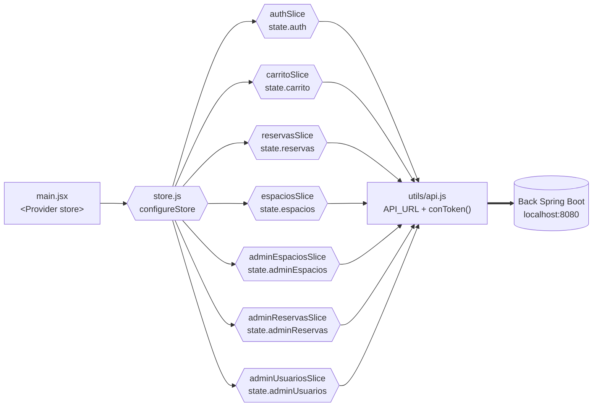

## 0.1 Ciclo de vida de un thunk (ejemplo: `login`)

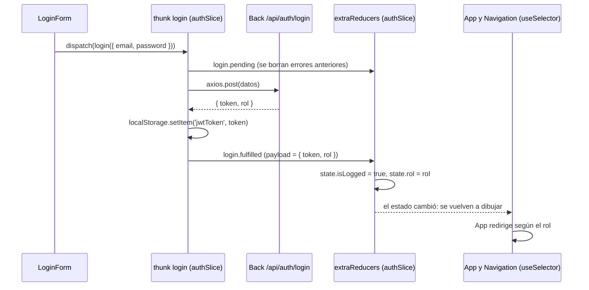

## 0.2 Cosas que comparten todas las pantallas (App y layout)

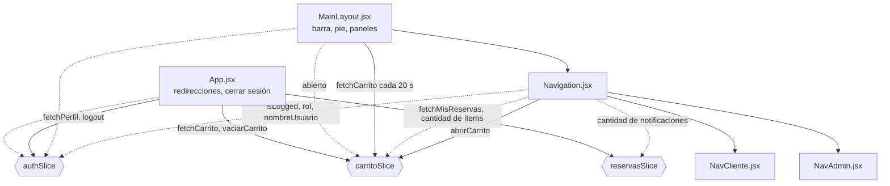

---

## 1. Inicio de sesión y registro (`/login`, `/register`)

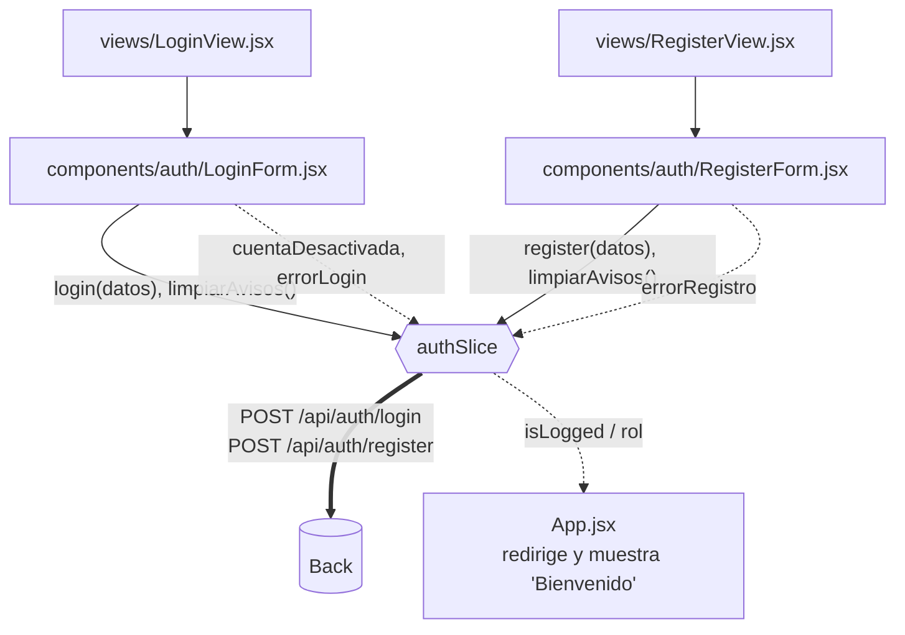

## 2. Catálogo (`/catalogo`)

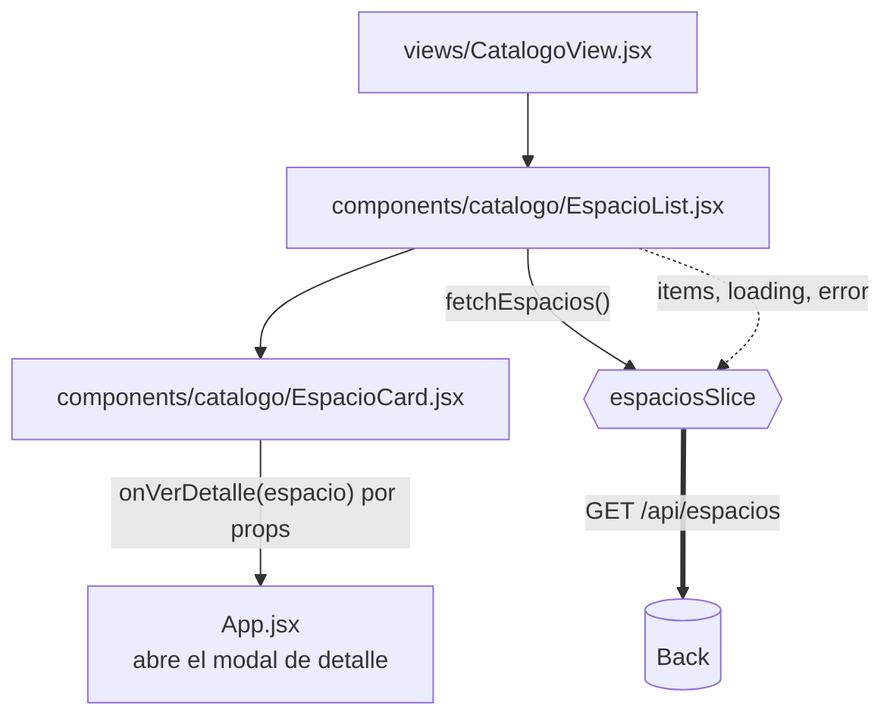

## 3. Detalle de un espacio (modal) y agregar al carrito

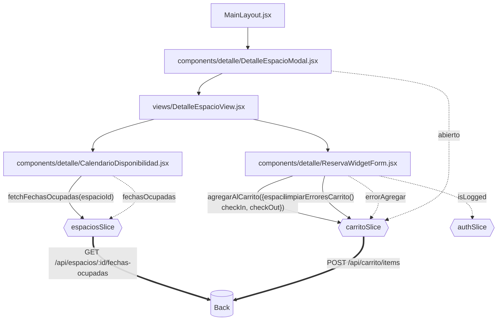

## 4. Carrito (panel lateral) y checkout (`/checkout`)

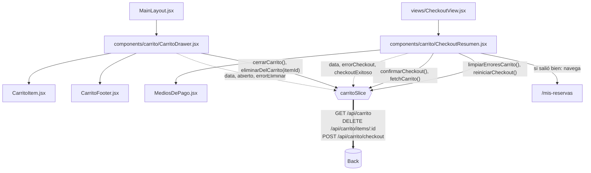

## 5. Mis reservas (`/mis-reservas`) y buzón de notificaciones

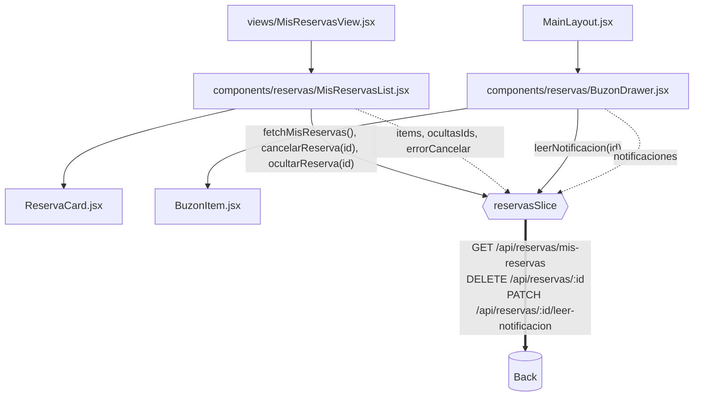

> `notificaciones` no viene del back por separado: el `fulfilled` de `fetchMisReservas` filtra las reservas canceladas por el admin que el cliente todavía no leyó.

## 6. Recorrido virtual (`/mapa-3d`)

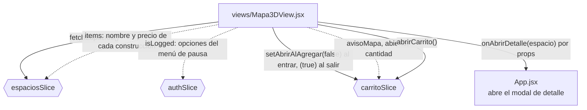

---

## 7. Admin: espacios (`/admin/espacios`)

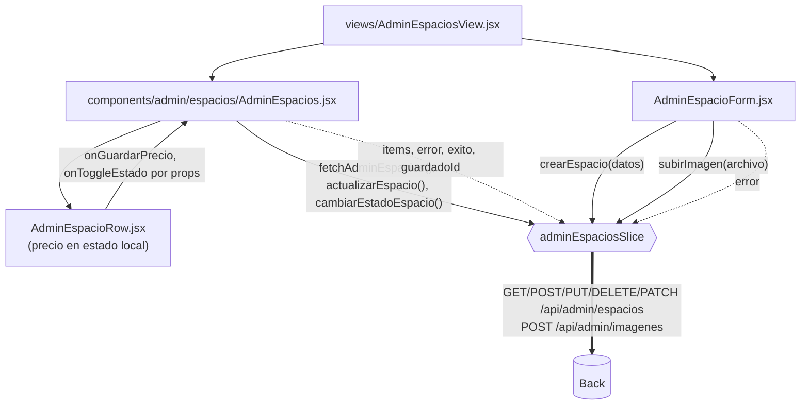

## 8. Admin: reservas (`/admin/reservas`)

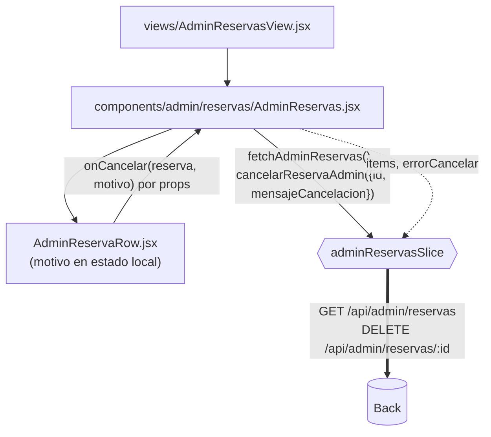

## 9. Admin: usuarios (`/admin/usuarios`)

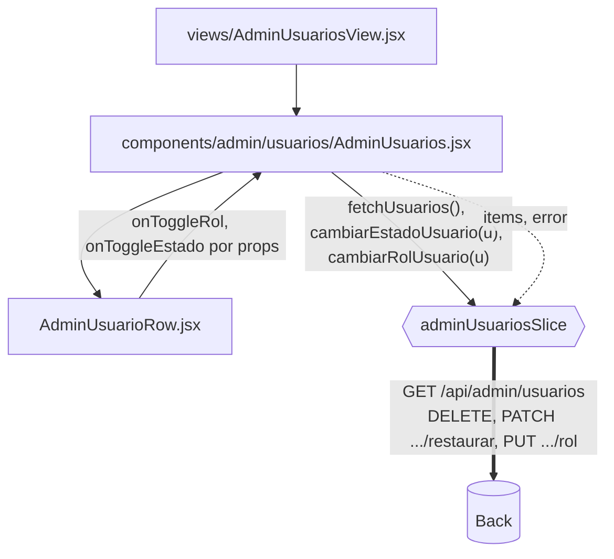

---

## 10. Tabla resumen: qué pantalla usa qué slice

| Pantalla | auth | carrito | reservas | espacios | adminEspacios | adminReservas | adminUsuarios |
|---|:-:|:-:|:-:|:-:|:-:|:-:|:-:|
| Todas (App, barra, layout) | ✓ | ✓ | ✓ | | | | |
| Login / Registro | ✓ | | | | | | |
| Catálogo | | | | ✓ | | | |
| Detalle (modal) | ✓ | ✓ | | ✓ | | | |
| Carrito y checkout | | ✓ | | | | | |
| Mis reservas y buzón | | | ✓ | | | | |
| Recorrido virtual | ✓ | ✓ | | ✓ | | | |
| Admin: espacios | | | | | ✓ | | |
| Admin: reservas | | | | | | ✓ | |
| Admin: usuarios | | | | | | | ✓ |
